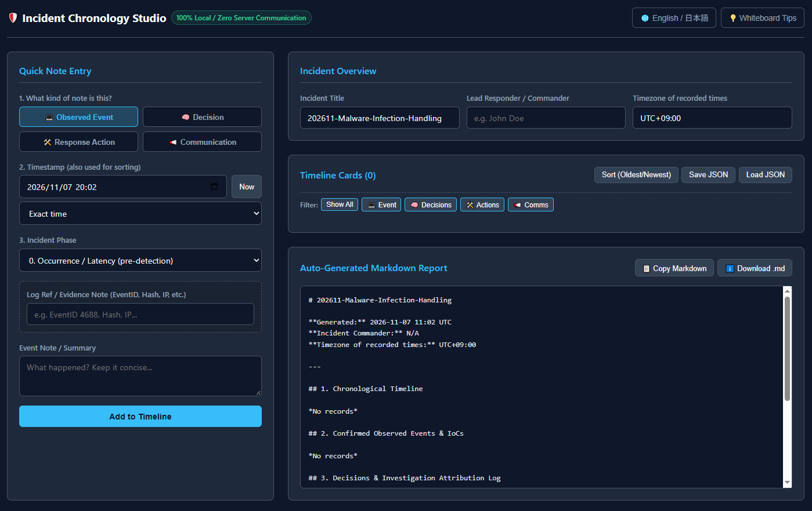

# 🛡️ Incident Chronology Studio

**A browser-only incident chronology and Markdown report generator for security responders. No server, no storage, no network.**

[Live demo](https://lex0xf0c.github.io/incident-chronology-studio/) · English / 日本語 · MIT License

<p align="center">
  
</p>

Incident Chronology Studio is a single HTML file that helps SOC analysts, CSIRT members and incident commanders keep a clean timeline while an incident is still unfolding. It separates **facts**, **decisions**, **actions**, **communications** and **unconfirmed possibilities**, and turns them into a structured report (Markdown or CSV, in English or Japanese) when you are done. For people new to incident response, guide templates ask what happened, what is being done and what comes next, so the gaps are easy to see.

Everything runs inside your browser tab. Nothing is sent anywhere, and nothing is written to the browser's storage.

---

## Why a chronology?

During an incident, memory fails and chat history scatters. A good chronology answers, afterwards and under pressure alike:

* **What happened, and when?** Including activity that began *before* anyone noticed.
* **Who decided what, and on what grounds?** Accountability and auditability.
* **What is fact and what is a guess?** Teams act better when the two are never mixed.
* **What was done, by whom, with what result?** The basis for the after-action report and lessons learned.
* **How long did each stage take?** Detection, containment and recovery times fall out of the same timeline.

This tool keeps those answers in one place, with as little friction as a whiteboard.

## Features

* **Five entry categories**
  | Category | Use it for |
  |---|---|
  | 💻 Observed Event | Confirmed technical facts: log lines, alerts, IoCs, hashes |
  | 🧠 Decision | Analyst or commander choices, with the decision maker and rationale |
  | 🛠️ Response Action | Isolation, collection, eradication, recovery: who did what, and the outcome |
  | 📢 Communication | Notifications and updates: recipient and channel |
  | ❓ Context & Potential Note | Unconfirmed information. Park it here, then **Confirm → Observed Event** once verified |
* **Flexible time input**: exact timestamp, a start → end range, or free text such as `Nov 5 night` for retroactive findings. A timestamp is always kept as the sort anchor. A timezone field is recorded in the report.
* **Incident phases (0–6)**: Occurrence / Latency (pre-detection), Detection, Triage, Containment, Forensics, Eradication / Recovery, Communication.
* **Milestones and durations**: optionally tag any entry as *Occurred*, *Detected*, *Declared*, *Contained*, *Eradicated*, *Recovered* or *Closed*. The report lists the milestones and calculates the time between them (for example Occurred → Detected, Detected → Contained). See [Milestones and durations](#milestones-and-durations) for the exact rules.
* **Guide templates (past, now, next)**: pick an incident type and fill in the blanks. Each question opens the entry form with the suggested category, phase and milestone already set. See [Guide templates](#guide-templates).
* **Edit, delete, sort and filter** timeline cards at any time.
* **Markdown report** with key milestones and durations, a chronological timeline table, and one section per category. Unconfirmed notes get their own clearly labelled section. When a guide template is selected, the report also lists the items that are still open. Copy it or download it as `.md`.
* **English or Japanese report**: choose the report language independently of the UI language. A report never mixes languages; your own entries are never translated.
* **CSV export** (UTF-8 with BOM, so Excel opens Japanese text correctly). One row per entry, with the time, end time, phase, milestone, linked guide item, summary and every category-specific field in its own column.
* **JSON save / load** to continue later or hand over to the next shift.
* **Built-in sample incidents** (English and Japanese) so you can see how it works in one click.
* **English and Japanese UI**, switchable at runtime.
* **Unsaved-work warning** before closing or reloading the tab.

### The note → fact workflow

Early in an incident most information is shaky. Record it as a **Context & Potential Note** with its basis and what would confirm or rule it out. When it is verified, press **Confirm → Observed Event**: the entry opens in edit mode as an Observed Event, with the basis pre-filled as evidence. Add the confirming evidence and save. The original timestamp is kept, and the report never presents an unconfirmed note as a fact.

### Milestones and durations

A milestone is an optional tag on an entry. It does not change the entry's category or phase.

| Milestone | Typical entry |
|---|---|
| Occurred | The earliest known malicious activity (often found retroactively, in Phase 0) |
| Detected | The alert or report that first revealed the incident |
| Declared | The decision to declare an incident |
| Contained | Containment is complete |
| Eradicated | Eradication is complete |
| Recovered | Systems and services are back to normal |
| Closed | The incident is formally closed |

How the report calculates durations:

* If several entries carry the same milestone, the **earliest** one is used.
* For the completion milestones (Contained, Eradicated, Recovered, Closed), an entry recorded as a **time range** counts at its **end** time. All other milestones use the start time.
* Times are used exactly as entered. They are **assumed to share one timezone**; nothing is converted.
* A milestone whose entry uses free-text time (for example `Nov 5 night`) only has an approximate timestamp. Intervals that involve it are marked *(estimated)*.
* If two milestones are out of order, the interval is marked *check order* instead of showing a negative duration.

Durations are a reporting aid, not a performance target. Shortening a stage is not a goal in itself.

### Guide templates

Pick an incident type in the Guide panel: *General first-response check*, *Suspected malware infection (endpoint)*, *Suspected ransomware* or *Account takeover / phishing*. The questions are grouped in three columns: **Past** (what happened), **Now** (what is being done) and **Next** (what comes next). Every item shows a short hint, which you can hide.

| State | Meaning |
|---|---|
| ✅ Recorded | At least one timeline entry other than an unconfirmed note is linked to the item |
| ❓ Unknown | Only an unconfirmed note is linked to the item |
| ➖ Not applicable | You marked it, optionally with a reason |
| ⬜ To do | Nothing recorded yet |

* **Record** opens the entry form with the category, phase and milestone suggested for that item. Saving links the new entry to the item.
* **Unknown** opens a *Context & Potential Note* with the question filled in. When you later press **Confirm → Observed Event**, the item becomes Recorded.
* The state is worked out from the timeline, so deleting a linked entry reopens the item.
* Items that are not recorded yet appear in the report under *Open Items*, which is handy for a handover.
* The small codes on each item (for example `RS.MI-01`) are reference labels from the NIST CSF 2.0 outcomes used in NIST SP 800-61r3. They are not a claim of compliance.
* The templates are short question lists, **not** operating procedures. Follow your organisation's own procedures. They contain no legal deadlines on purpose: check the latest laws and contracts for notification duties.

## Quick start

No build tools, no dependencies, no server.

1. Download `index.html` (or clone the repository).
2. Open it in any modern browser: Chrome, Edge, Firefox or Safari.
3. Click **Load sample** to explore, or start adding entries.
4. Before closing the tab, click **Save JSON**. Your data lives only in memory.

You can also host `index.html` on GitHub Pages or any static web server. For sensitive incidents, download the file and open it locally instead: you then depend on no hosting provider at all, and it works fully offline and on air-gapped machines.

## Privacy and security design

The core promise: **incident data never leaves your machine, and never lingers on it unless you export it.**

| Principle | How it is enforced |
|---|---|
| No network communication | A `Content-Security-Policy` meta tag sets `default-src 'none'` and `connect-src 'none'`. The browser itself blocks requests to other origins, even if code were changed by mistake. |
| No external resources | All HTML, CSS and JavaScript live in one file. No CDN, fonts, analytics or third-party scripts. |
| No persistent browser storage | No `localStorage`, `sessionStorage`, `IndexedDB` or cookies. Closing or reloading the tab discards all unsaved data, so hostnames, IPs and IoCs do not remain on the workstation. |
| User-controlled export | Data leaves the page only when you click Save JSON, Copy Markdown, Download .md or Download .csv. |
| XSS defence | Every user-supplied value is HTML-escaped before it reaches the DOM. No `eval`, no `new Function`, no inline event handlers. |
| Safe JSON import | Imported files are parsed with `JSON.parse` only. Categories, phases, milestones, guide item IDs, the template ID and timestamps are validated against allow-lists, strings are length-limited, unknown entries are dropped and IDs are regenerated. |
| Spreadsheet-safe CSV | Cells that begin with `=`, `+`, `-`, `@`, a tab or a carriage return get a leading `'`, so a spreadsheet does not run them as formulas. |

### Limits of this design

This tool protects the page, not the machine around it. Out of scope:

* A compromised workstation, operating system or browser.
* Malicious browser extensions or keyloggers.
* Exported JSON, Markdown and CSV files. They are plain text, so protect them as you would any incident record (encrypted storage, appropriate TLP handling).
* The integrity of the file you download. If you use the hosted demo, verify the file against the repository, or build your trust once and keep your own copy.
* The CSV safeguard covers the common formula prefixes only. Treat an exported CSV from untrusted data with the same care as any other spreadsheet.

A `<meta>` CSP cannot set `frame-ancestors`. If you host the page yourself and need clickjacking protection, add that header at the web server.

## Data format

**JSON (schema version 4)**

```json
{
  "app": "incident-chronology-studio",
  "schemaVersion": 4,
  "meta": { "title": "…", "commander": "…", "tz": "UTC+01:00" },
  "template": { "id": "malware", "na": { "c.lead": "Reason for not applicable" } },
  "items": [
    {
      "id": "…",
      "category": "OBSERVED_EVENT",
      "timeMode": "exact",
      "time": "2026-11-05T09:12",
      "timeEnd": "",
      "timeText": "",
      "phase": "p1",
      "milestone": "detected",
      "slot": "c.first",
      "summary": "EDR alert: suspicious beaconing from FIN-PC-014.",
      "evidence": "EDR alert #48213"
    }
  ]
}
```

* `category`: `OBSERVED_EVENT`, `DECISION`, `ACTION`, `COMMUNICATION` or `CONTEXT_NOTE`.
* `timeMode`: `exact`, `range` or `text`. `time` (format `YYYY-MM-DDTHH:mm`) is always the sort anchor.
* `phase`: `p0` to `p6`.
* `milestone`: empty, or one of `occurred`, `detected`, `declared`, `contained`, `eradicated`, `recovered`, `closed`.
* `slot`: empty, or the ID of the guide item the entry is linked to (for example `c.first`).
* `template`: `id` is empty or one of `generic`, `malware`, `ransom`, `account`; `na` maps guide item IDs to the reason given for marking them not applicable.
* Category-specific fields: `evidence` · `actor`, `rationale` · `assignee`, `artifact` · `recipient`, `channel` · `basis`, `verify`.
* Files from earlier versions are still accepted: version 3 files have no `template` or `slot`, version 2 files also have no `milestone`, and version 1 files (`eventTime`, English phase names) are converted on import.

**Markdown report**: header (title, commander, timezone, generation time in UTC), then `1. Key Milestones & Durations`, `2. Chronological Timeline`, `3. Confirmed Observed Events & IoCs`, `4. Context & Potential Notes (Unconfirmed)`, `5. Decisions`, `6. Response Actions`, `7. Stakeholder Communications`, and, when a guide template is selected, `8. Open Items (Guide Template)`. The report is written in the language chosen in the report language selector (English or Japanese), which follows the UI language by default.

**CSV**: one header row and one row per entry, sorted by time. Columns: time, end time, time description, type, phase, milestone, guide item, summary, then one column for each category-specific field (empty where a field does not apply to the entry's category). The header text follows the report language.

## Scope and status

This is a note-taking and reporting aid. It is **not** a case management system, a SIEM, or a replacement for your ticketing and evidence-handling procedures. It is a young project: expect rough edges, and review the generated report before you rely on it.

The phase list and the milestones follow the general shape of common incident lifecycles (see the NIST SP 800-61 and ENISA incident management guidance) but are **not** a formal implementation of either. The guide templates are short question lists, not operating procedures, and the CSF labels on them are references only. Ideas under consideration include a milestone progress bar and "next three" suggestions, importing and exporting your own templates, more templates, a CSF coverage view, a Post-incident / lessons-learned phase, incident ID, severity and classification fields, and a Traffic Light Protocol marking for reports.

## Development

* One file: `index.html`. Vanilla HTML5, CSS3 and ES6+. No build step, bundler or package manager.
* Contributors and AI coding agents: read [`AGENTS.md`](AGENTS.md) first. It defines the security invariants that every change must keep.
* All sample data is fictional and uses reserved documentation addresses and names only.

## License

MIT. See [`LICENSE`](LICENSE).
